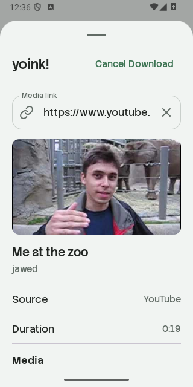
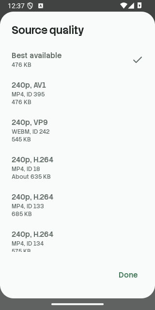
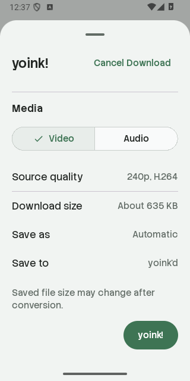
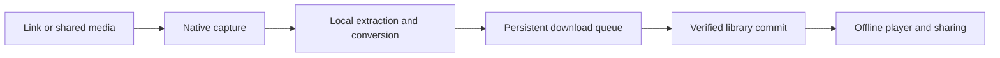

# Native Android port of yoink'd

## Goal

Port the iOS app's local media workflow to Kotlin and Jetpack Compose.
Keep the display name `yoink'd`, Android application ID and namespace `com.maynkudu.yoinkd`, original brand artwork, Stack Sans Text/Notch fonts, and six themes.
Build an installable APK and verify capture, downloads, library, history, settings, storage, and offline playback on the Pixel 8 Android 15 emulator.

The fixed source is [maynkudu/yoinkd at 0c6ba72](https://github.com/maynkudu/yoinkd/tree/0c6ba72b046b3a250d8f27754bc6090d2217f264). Its source and assets are pinned under `reference/ios/`. This is a native Android adaptation. Android owns navigation controls, keyboard behavior, file selection, sharing, notifications, and background execution. iOS Liquid Glass and AVKit are replaced by native Android equivalents. No redesign of the product's feature taxonomy is proposed.

## Representative preview

The isolated Kotlin app is in `.plannotator/android-port/prototype/`. It is installed separately on the Pixel 8 as `Maynkudu.yoinkd.preview`. Its display name is `yoink'd`. The production app will use `com.maynkudu.yoinkd`.

The preview renders the original brand mark and fonts with the iOS palette calculation. Rune outline icons retain their published SVG paths and stroke widths. The capture sheet performs real on-device link inspection with yt-dlp, CPython, QuickJS, and FFmpeg. It exposes source metadata, Video/Audio selection, every usable source quality, exact or estimated download sizes, and output selection.

Queue presentation and Settings controls in this preview are simulated. A preview download does not save a file. The full persistent queue, storage, players, share target, and updates are implementation work after approval. This preview is evidence for the native build, rendering, and inspection approach, not evidence of completed feature parity.

Capture conditions are the existing Pixel 8 emulator on Android 15. No iOS simulator is available on this Arch Linux host. Native control geometry will differ between platforms. iOS pixel fidelity is unverified and is not the acceptance criterion for this Android adaptation.

Verified preview behavior: the public YouTube link `https://www.youtube.com/watch?v=jNQXAC9IVRw` returned `Me at the zoo`, uploader `jawed`, duration `0:19`, and actual source formats. The quality picker distinguishes AV1, VP9, H.264 and separate same-resolution source IDs. Choosing the H.264 combined stream returns to capture with that selection. Android runtime logs contained no crash. Full downloads and playback have not been verified yet.





[Capture interaction recording](capture-flow.mp4), 4.68 seconds, H.264, 320 by 640 pixels. The recording opens the real quality picker and selects source format 18. The dialog now uses the shared Sage palette.



## Accepted behavior to implement

| Area | Android behavior | iOS source |
| --- | --- | --- |
| Capture | Paste, clear, validate HTTPS, cancel inspection, show metadata, choose Video/Audio, all usable source variants, saved output format, and honest source sizes. A share/deep link opens capture for confirmation. | `Features/Capture/AddLinkView.swift`, `YoinksCore/SourceMedia.swift`, `CaptureRequest.swift` |
| Extraction | Public links resolve locally through yt-dlp and bundled QuickJS. Every attempt refreshes the webpage rather than persisting expiring stream URLs. FFmpeg merges, remuxes, converts, and handles artwork/metadata. | `Services/NativeExtractor.swift`, `AppResources/Extractor/iyoinks_extract.py` |
| Downloads | Queued, extracting, downloading, processing, saving, paused, completed, failed, and cancelled states. Two occupied slots, at most one source acquisition. Pause/resume/retry retain partial files. Attempt IDs reject stale events. A completed job requires a validated file and committed library row. | `Services/DownloadQueue.swift`, `YoinksCore/DownloadRules.swift` |
| Background | A foreground data-sync service runs user-started work with a progress notification. Interrupted work restores as paused. Android's time limit pauses work without deleting checkpoints. | `Services/SourceBackgroundWork.swift` |
| Library | Real local files, thumbnails, durations, file sizes, search, All/Video/Audio filters, persistent sort and grid/list display, rename, native sharing, deletion, and multiple file imports. | `Features/Library/LibraryView.swift`, `LibraryRow.swift`, `Services/MediaLibrary.swift` |
| History | Terminal jobs grouped by creation date, search, persistent sort/display/filter, retry, removal, and confirmed clear history. Clearing history preserves library files. Deleted files remain identifiable in history. | `Features/Downloads/HistoryView.swift` |
| Playback | Offline audio with artwork, artist, seek, play/pause, 15-second skips, system volume, Info, and Share. Embedded video and fullscreen retain the same player. Release observers/player and audio focus on dismissal. | `Features/Library/MediaDetailView.swift`, `MediaPlayback.swift` |
| Storage | Default public `Downloads/yoink'd` folder. Android's document picker selects an alternative folder with persistent access. Relocation copies and verifies only managed media before switching; it refuses collisions and is blocked during unfinished work/imports. Metadata and temporary files remain private. | `Services/MediaStorage.swift`, `MediaFolderPreferences.swift`, `YoinksCore/MediaFileStore.swift` |
| Appearance | System/Light/Dark, Neutral/Sage/Lavender/Amber/Ocean/Dynamic, Sage by default. Dynamic uses selected or preview artwork, rejects stale results, and falls back to neutral. Respect system font scaling and disabled animations. | `App/AppTheme.swift`, `AppTypography.swift`, `YoinksCore/AccentPalette.swift` |
| Updates | Installed/latest extractor versions, check and update controls, visible progress and errors, verified downloads and rollback. Android bundled runtimes and certificate data require an app update. EJS follows the compatible extractor package. This adapts the iOS package-delivery mechanism to the Android runtime. | `Services/ExtractorDependencies.swift`, `Features/Settings/DependencyUpdatesSection.swift` |

Video outputs preserve Automatic, MP4, and MOV. Audio outputs preserve Automatic, AAC/M4A, MP3, FLAC, ALAC, WAV, AIFF, and CAF when the bundled encoders/muxers support them. The app probes actual availability. Conversion explanations describe size changes and preserve the source's lossless-audio caveat. Unsupported playback formats can use a private playable conversion while preserving the original saved file.

## App organization and boundaries

Use one Android app module. Keep Gradle dependency versions in a version catalog, include the Gradle wrapper, and keep generated output separate. Constructor injection through a small application container is sufficient for this app.

```text
app/
  src/main/java/com/maynkudu/yoinkd/
    MainActivity.kt
    YoinkApplication.kt
    app/                 Application container, root navigation, incoming requests
    core/model/          Links, media, source selections, queue states, preferences
    core/design/         Palette math, licensed typography, common native controls
    data/database/       Room entities, DAOs, database, transaction boundaries
    data/extraction/     yt-dlp adapter, FFmpeg process control, package updates
    data/storage/        MediaStore, selected folders, verified file operations
    download/            Coordinator, direct transfer, foreground service
    feature/capture/     Link sheet and quality/output selection
    feature/library/     Saved media, imports, search, filtering, item actions
    feature/downloads/   Active and queued work
    feature/history/     Terminal jobs and history controls
    feature/player/      Audio, video, fullscreen, file info
    feature/settings/    Appearance, folders, statistics, extraction updates
  src/main/res/          Android resources and original assets
  src/test/              Focused domain/queue/format tests
  src/androidTest/      Storage/database integration checks
  schemas/              Generated Room schema snapshots
gradle/libs.versions.toml
scripts/                 Asset packaging and focused verification entry points
docs/                    Feature comparison, architecture, and verification evidence
reference/               Fixed iOS source and asset provenance
.plannotator/            Isolated preview and human review evidence
```

The UI observes repository state through Flow and ViewModels. It does not write SQL or invoke native processes. The download coordinator controls attempt identity and scheduling. Extraction and storage do not own navigation. Library commit and download completion share a Room transaction. File operations keep a recoverable record until the database commit succeeds.

## Implementation sequence and checks

1. Build the Android project, app identity, models, database, preferences, original assets, and theme. Verify model behavior and palette values against the fixed Swift source.
2. Implement capture, extraction, direct transfers, conversion, durable queue, foreground work, and verified library commits. Check a short public YouTube video and a direct HTTPS media file on the emulator. Check pause/resume, retry, cancellation, and relaunch recovery.
3. Implement Library, History, imports, native sharing, rename/delete, audio/video playback, fullscreen, and folder relocation. Check real files and database records as well as the visible result.
4. Implement Settings, all themes, artwork selection, update state, and final accessibility/keyboard handling. Check light/dark, narrow portrait, landscape/fullscreen, larger text, search dismissal, and relevant controls.
5. Build the final APK, run focused tests and Android lint, inspect app logs, record checked flows, and open the implementation diff in Plannotator. Keep successful checks distinct from blocked source/network checks.

The Android baseline is Android 10 or newer, with compile/target SDK 35 for the installed SDK and emulator. Public scoped storage avoids broad storage permissions. No login, DRM, playlists, multi-video posts, active livestreams, server backend, cloud sync, or iOS database migration is added. Those exclusions match the current iOS release where applicable.

Third-party runtime and icon/font license notices ship with the source and app. The debug APK is for development. No commit, push, store submission, or external publication is included.
